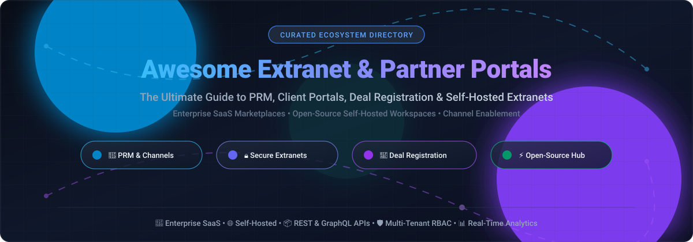

# Awesome-Extranet-Partner-Portal-Management 🚀

  

  
  
  
  
  
  
  

---

## 🌟 Top Extranet & Partner Portal Management Ecosystem

> **Curated List of SaaS Platforms & Open-Source GitHub Projects for Channel Enablement, Deal Registration, Partner Relationship Management (PRM) & Self-Hosted Client Extranets.**  
> *Last updated: March 2026*

This repository tracks notable **SaaS platforms** and **open-source projects** for **Extranet & Partner Portal Management**. These tools empower organizations to collaborate securely with external partners—dealers, resellers, distributors, agencies, freelancers, and suppliers—covering everything from lead distribution and deal registration to co-marketing, multi-tenant document exchange, and project management.

### 🎯 Key Highlights:
- 🏢 **Enterprise SaaS Solutions**: Comprehensive comparison of category leaders (Salesforce Experience Cloud, Impartner PRM, Zoho Portals, Magentrix, Allbound, Channeltivity) with starting tier prices, specific free trial / free tier limits, and corporate scale.
- ⚡ **Self-Hosted Open-Source Alternatives**: Battle-tested open-source repositories (Twenty, Odoo, ERPNext, Invoice Ninja, SuiteCRM, ProjectSend, Atrium, ClientShare) with live star badges linked to stargazers and sorted descending by popularity.
- 🛡️ **Data Sovereignty & Cost Efficiency**: Eliminate compounding per-seat external user licensing fees with self-hostable Docker, Node, PHP, Python, and Go solutions.

---

## 📑 Table of Contents
- [📊 Sector Overview & Market Dynamics](#-sector-overview--market-dynamics)
- [☁️ SaaS & Hosted Platforms](#️-saas--hosted-platforms)
- [💻 Open-Source GitHub Projects](#-open-source-github-projects)
- [🤝 How to Contribute](#-how-to-contribute)
- [💖 Support](#-support)
- [⭐ Star History](#-star-history)
- [⚠️ Disclaimer](#️-disclaimer)

---

## 📊 Sector Overview & Market Dynamics

The global Partner Relationship Management (PRM) and Extranet software market is estimated at approximately **$3B to $5B** for core software solutions (expanding past **$15B+** when factoring broader digital workplace, client portal, and indirect channel enablement ecosystems), growing at a compound annual growth rate (**CAGR**) of **14%–17%**. 

The sector is **moderately fragmented**: mega-cap enterprise CRM vendors (led by Salesforce Experience Cloud) command high enterprise market share, while specialized pure-play PRM platforms (such as Impartner, Magentrix, Channeltivity, and Allbound) fiercely compete alongside an expanding wave of self-hosted open-source workspaces (Twenty, Odoo, ERPNext, SuiteCRM, Invoice Ninja) to meet mid-market agility and strict data sovereignty requirements.

---

## ☁️ SaaS & Hosted Platforms

| Product | Company Size (Valuation / Revenue) | Starting Pricing | Free Tier / Trial Limits | Description |
|---------|-----------------------------------|------------------|--------------------------|-------------|
| **[Salesforce Experience Cloud](https://www.salesforce.com/products/experience-cloud/)** | ~$200B–$250B Market Cap (~$38B FY25 Rev) | $25/member/month (Partner Community, billed annually) or $10/login | No permanent production free tier. 30-day free trial on CRM parent orgs, or free permanent Developer Edition (capped at 5 MB data storage, 20 MB file storage, and 5,000 API requests/day). | **The enterprise partner portal standard.** Build branded partner communities with deal registration, lead distribution, training materials, and reporting. Requires at least one Enterprise Edition Salesforce license to host. |
| **[Zoho Portals (Creator / CRM)](https://www.zoho.com/)** | ~$12.5B Valuation (~$1.5B FY25 Rev) | $8/user/month (Zoho Creator Standard) + $100/month per block of 250 external portal users | Free forever plan available (capped at 1 app, 1 user, and 5,000 total records); 15-day free trial on paid tiers (unlocked features, no credit card required). | External partner/client access portal capabilities across the Zoho ecosystem (Creator & CRM), enabling custom partner interfaces, record workflows, and role-based permissions. |
| **[Impartner PRM](https://www.impartner.com/)** | ~$35M–$45M ARR ($110M+ Raised) | $2,000/month ($25,000/year billed annually for Emerge tier) | No permanent free tier; 30-day trial available exclusively via partner marketplace programs (HubSpot integration) or custom demo sandboxes upon sales qualification. | **Purpose-built partner relationship management.** Channel enablement, deal registration, partner onboarding, and performance analytics positioned for enterprises with complex channel programs. |
| **[Allbound](https://www.allbound.com/)** | ~$43M Growth Investment (~$7M+ ARR) | $3,495/month (annual commitment) | No free tier and no self-service free trial; product evaluation requires a scheduled sales demonstration. | Partner sales and marketing enablement platform focused on content distribution, deal registration, training, and partner collaboration. |
| **[Magentrix](https://www.magentrix.com/)** | ~$5M ARR (Bootstrapped/Private) | $1,500/month (Essential PRM tier, includes ~100 partner users / 10 partner accounts) | No permanent free tier; 1-month trial option offered upon plan onboarding. | PRM and partner portal platform offering seamless CRM integration (Salesforce/HubSpot), deal registration, content management, and partner training with zero setup fees. |
| **[Channeltivity](https://www.channeltivity.com/)** | ~$1.5M ARR (Private/Bootstrapped) | $1,199/month (Growth tier, billed annually) | No free tier and no free trial; access requires a custom sales consultation and live product demonstration. | PRM platform with deal registration, lead distribution, partner onboarding, and channel marketing tools tailored for mid-market channel programs. |

---

## 💻 Open-Source GitHub Projects

Curated self-hosted partner portals, extranets, client collaboration spaces, and CRM foundation frameworks sorted descending by GitHub star count:

| Project | Star Badge | Description |
|---------|:----------:|-------------|
| **[Twenty](https://github.com/twentyhq/twenty)** |  | **Modern open-source CRM that can be extended into a partner portal workspace.** Self-hostable with Docker or Railway (PostgreSQL, Redis, MinIO pre-wired). Supports custom objects to model partners, agencies, deal registrations, and RFP responses with granular RBAC and GraphQL/REST APIs. |
| **[Odoo](https://github.com/odoo/odoo)** |  | **World-renowned modular open-source ERP & CRM suite featuring a dedicated Partner & Customer Portal.** Enables external partners and clients to manage quotations, review signed sales orders, access shared documents, submit tickets, and track invoices in an isolated external workspace. |
| **[ERPNext](https://github.com/frappe/erpnext)** |  | **Full-featured open-source business application suite powered by the Frappe framework.** Features an out-of-the-box self-service Partner and Supplier Portal with supplier quotation bidding, purchase order tracking, issue management, and custom doctype exposure. |
| **[Invoice Ninja](https://github.com/invoiceninja/invoiceninja)** |  | **Leading self-hosted client & partner billing portal.** Built with Laravel and Flutter; includes a comprehensive white-label `/client/login` portal where clients and partners can approve quotes, download statements, make online payments, and manage invoices. |
| **[SuiteCRM](https://github.com/suitecrm/SuiteCRM)** |  | **Enterprise-grade open-source CRM with a dedicated external Customer & Partner Portal.** Delivers role-based access control, case/ticket lifecycle tracking, document libraries, and account contract oversight for external collaborators. |
| **[ProjectSend](https://github.com/projectsend/projectsend)** |  | **Established open-source secure file-exchange extranet.** Provides self-hosted document distribution with dedicated private client/partner pages, TOTP two-factor authentication, quota enforcement, expiring links, audit trails, and granular RBAC. |
| **[Open Mercato](https://github.com/open-mercato/open-mercato)** |  | **B2B PRM partner portal module and reference architecture.** Defines Partner Dashboards (tier status, KPI summaries, RFP inboxes), case study submissions, agency onboarding flows, and partner-specific RBAC roles (`portal.partner.access`, `portal.partner.kpi.view`). |
| **[Atrium](https://github.com/Vibra-Labs/Atrium)** |  | **Self-hosted client portal tailored for agencies and freelancers with built-in project management.** Next.js & Docker-ready with integrated PostgreSQL; delivers milestone tracking, file sharing via S3/R2/local, white-label branding, and client role management. |
| **[ClientShare](https://github.com/pixelcop/clientshare)** |  | **Lightweight open-source branded client portal for secure document exchange.** Single Go binary + Vue frontend with SQLite/local storage (upgradeable to Postgres/S3), expiring download links, invite workflows, and custom theme customization. |
| **[OpenG2P Partner Management](https://github.com/OpenG2P/partner-management)** |  | **Partner management service for government-to-person and public-sector ecosystems.** Centralized API and staff portal for onboarding external institutional partners, issuing cryptographic keys, and rotating credentials securely. |

---

## 🛠️ Framework Recommendations

* 📁 **For Secure Document & File Extranets**: Choose **ProjectSend** or **ClientShare** for branded external document distribution without recurring cloud storage fees.
* 📋 **For Agency & Freelance Client Portals**: Choose **Atrium** for combined project task boards, milestone tracking, and client deliverables.
* 💳 **For Financial & Client Billing Portals**: Choose **Invoice Ninja** for self-hosted payment handling, quote sign-offs, and statement visibility.
* 🧩 **For Extensible PRM & Channel Infrastructure**: Choose **Twenty**, **Odoo**, or **ERPNext** to build bespoke deal registration pipelines, partner tiers, and custom portal views with enterprise-ready RBAC.

---

## 🤝 How to Contribute

Contributions are welcome and greatly appreciated! 

1. 🍴 **Fork** the repository.
2. 🌿 Create a new feature branch (`git checkout -b feature/add-new-portal`).
3. 📝 Add your entry to `README.md` following the existing tabular structure.
4. 🔗 Include factual pricing, free tier / trial parameters, or live GitHub links.
5. 🚀 Submit a **Pull Request** with a clear description of the project.

---

## 💖 Support

If you find this curated ecosystem directory helpful, consider supporting the maintenance and ongoing updates:

- ⭐ **Star** this repository on GitHub!
- 🍴 **Fork** and share it with colleagues, channel ops teams, and agency owners.
- ☕ **Sponsor / Buy Me a Coffee**: Support development on the [GitHub Sponsors Dashboard](https://github.com/sponsors/ishandutta2007)!

---

## 📈 Star History

---

## ⚠️ Disclaimer

- This repository is a **community-curated collection** provided for educational and architectural evaluation purposes.
- Extranets and partner portals interface with external user credentials, commercial contracts, and sensitive financial documentation. Always implement strong authentication (TOTP/MFA), audit logging, and least-privilege RBAC policies.
- Licensing and starting costs for commercial vendors (Salesforce, Impartner, Zoho, Magentrix, Allbound, Channeltivity) change periodically. Please consult vendor sales representatives for definitive enterprise quotes.

---

  <b>Built for channel managers, partner operations teams, and architects designing external collaboration infrastructure.</b> 
  Let's make extranet and partner portal management more open, transparent, and developer-friendly!

